<p align="center">
  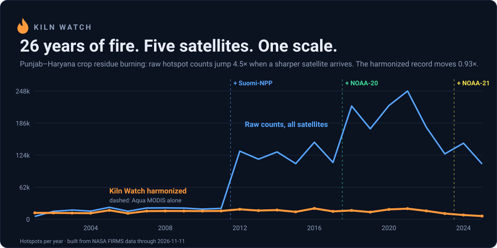
</p>

<h1 align="center">Kiln Watch</h1>

<p align="center">
  <b>One fire record for any place on Earth, from 2000 to today, that does not jump when satellites change.</b><br>
  NASA Space Apps Challenge 2026 · <i>Harmonization of MODIS and VIIRS Hot Spots</i> · Team Off The Binary, Bangladesh
</p>

<p align="center">
  <a href="https://kiln-watch-seven.vercel.app"></a>
  <a href="docs/TECHNICAL.md"></a>
  <a href="https://kiln-watch-seven.vercel.app/#pg=mcp"></a>
</p>

<p align="center">
  
  
  
  
  
  
</p>

<p align="center">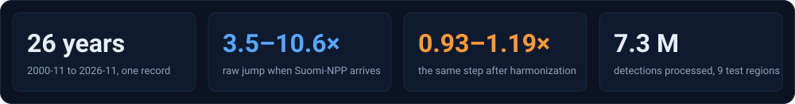</p>

<p align="center"><sub>The live demo serves the nine prebuilt regions. Run it locally to build any place on Earth.</sub></p>

---

## The problem, in one picture

In 2012 a sharper satellite started counting smaller fires. Nothing changed on the ground. The record did.

<p align="center">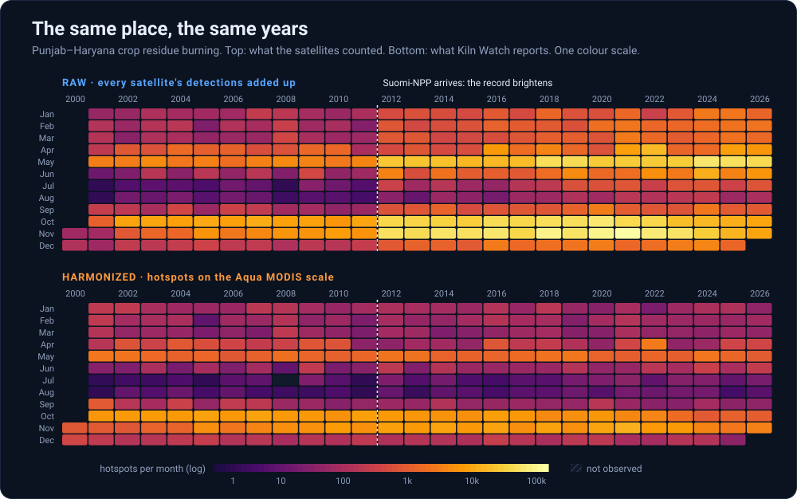</p>

## The fix

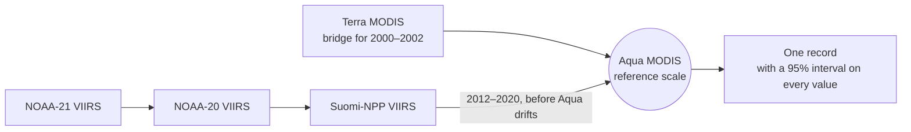

- **Why Aqua?** Its afternoon orbit is the only one flown continuously from 2002 through every VIIRS satellite.
- **How?** Ratio of totals per calendar month, day and night apart, shrunk by empirical Bayes. No black box.
- **Which satellites, when?** Read from the data. Suomi-NPP's end on 2 November 2026 was detected, not typed in.

<p align="center">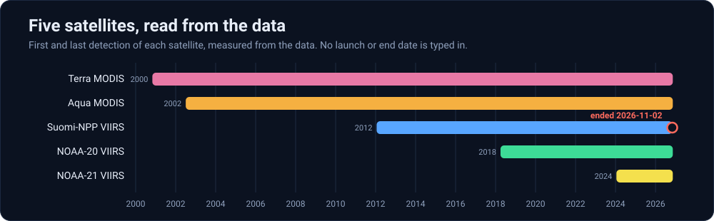</p>

## The proof

We test the record the way the future will: by taking satellites away.

<p align="center">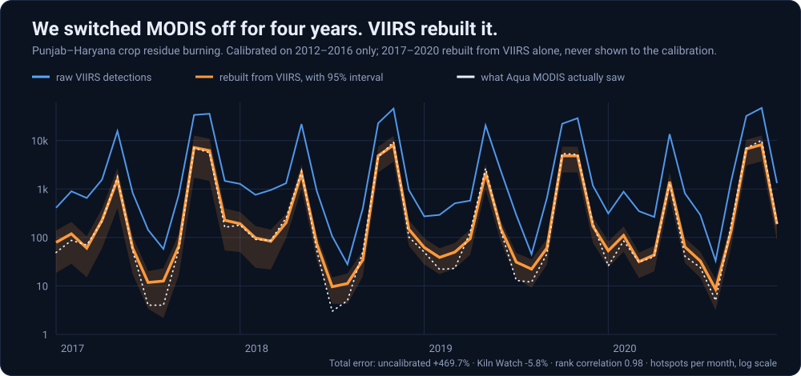</p>

<p align="center">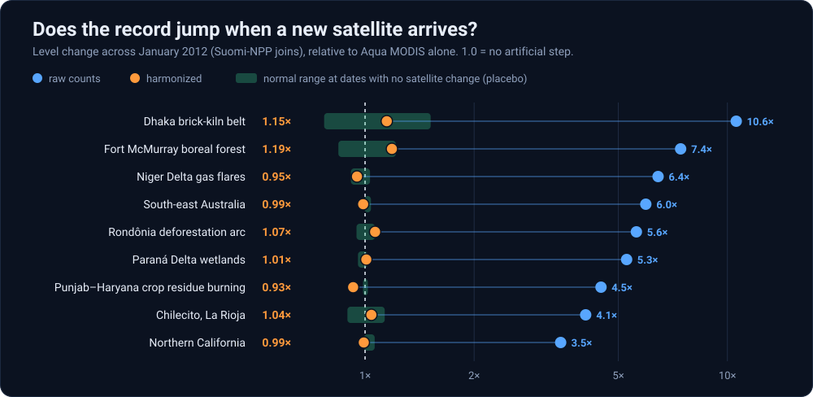</p>

<details>
<summary><b>Full results table, nine regions</b></summary>

<br>

| Region | Raw step ÷ Aqua | Harmonized step ÷ Aqua | Error, uncalibrated | Error, Kiln Watch | Rank ρ | 95% interval coverage | Trend/yr raw | harmonized | Aqua only |
|---|---|---|---|---|---|---|---|---|---|
| Dhaka brick-kiln belt | 10.58 | 1.15 | +1864.3% | +13.1% | 0.67 | 96% | 0.7 | 0.0 | 0.0 |
| Punjab–Haryana crop residue burning | 4.48 | 0.93 | +469.7% | -5.8% | 0.98 | 96% | 72.5 | 0.0 | -0.1 |
| Chilecito, La Rioja | 4.06 | 1.04 | +812.3% | -9.7% | 0.89 | 96% | 2.5 | 0.0 | 0.0 |
| Rondônia deforestation arc | 5.61 | 1.07 | +516.5% | -0.6% | 0.98 | 96% | 18.1 | -0.1 | -0.2 |
| Fort McMurray boreal forest | 7.43 | 1.19 | +1030.2% | -8.9% | 0.83 | 96% | 1.7 | 0.0 | 0.0 |
| South-east Australia | 5.95 | 0.99 | +815.3% | +4.1% | 0.98 | 96% | 34.4 | -0.9 | -1.0 |
| Northern California | 3.47 | 0.99 | +782.9% | +8.1% | 0.98 | 96% | 33.5 | 1.0 | 0.7 |
| Paraná Delta wetlands | 5.27 | 1.01 | +597.0% | +27.5% | 0.94 | 96% | 6.0 | -1.6 | -1.7 |
| Niger Delta gas flares | 6.44 | 0.95 | +580.5% | -1.7% | 0.98 | 96% | 34.3 | 0.2 | 0.1 |

Errors are from the MODIS-denial test (calibrate on 2012–2016, rebuild 2017–2020 from VIIRS alone). The 96% coverage holds
by construction: intervals are widened to reach 95% on that test. Trends are Sen slopes for 2003–2020.
How to read every column: [docs/TECHNICAL.md](docs/TECHNICAL.md).

</details>

**Where it still falls short.** We publish these, not hide them.

- Five of nine regions land inside their no-change range. Punjab clearly misses: it still under-corrects by about 7%.
- Paraná Delta is off by +27%. Its record 2020 fire year is unlike anything the calibration years saw.
- No cloud-cover correction yet, and the early-warning rule has not been backtested.

---

## The product

<p align="center">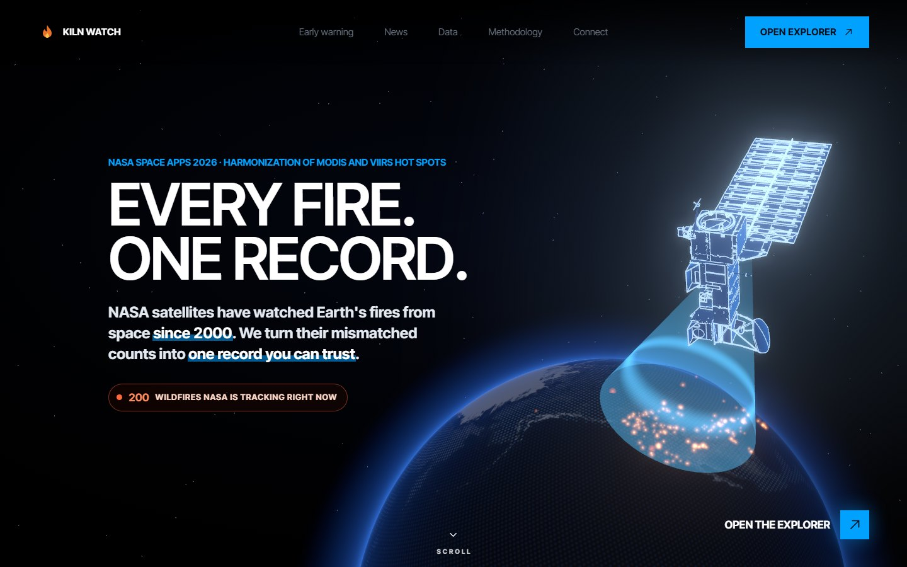</p>

<table>
<tr>
<td width="50%" valign="top">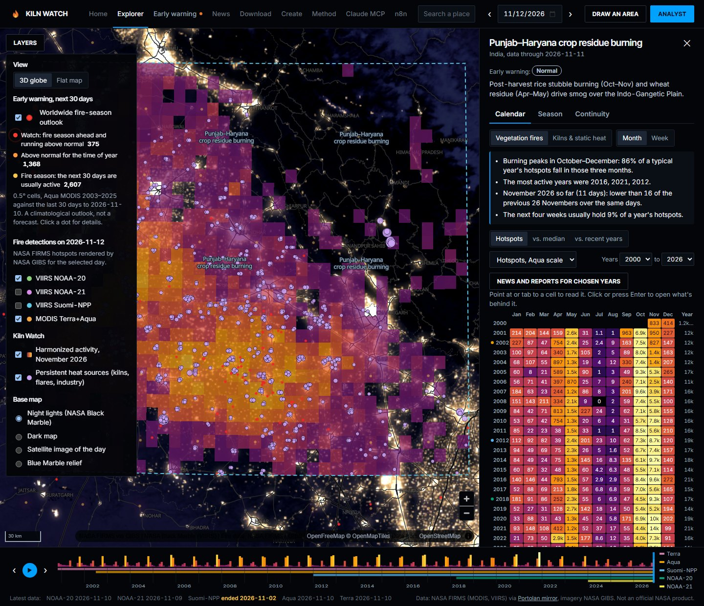<br><b>Burning calendar.</b> Month by year, number in every cell, colour-blind-safe, keyboard navigable. Click a cell for the detections behind it.</td>
<td width="50%" valign="top">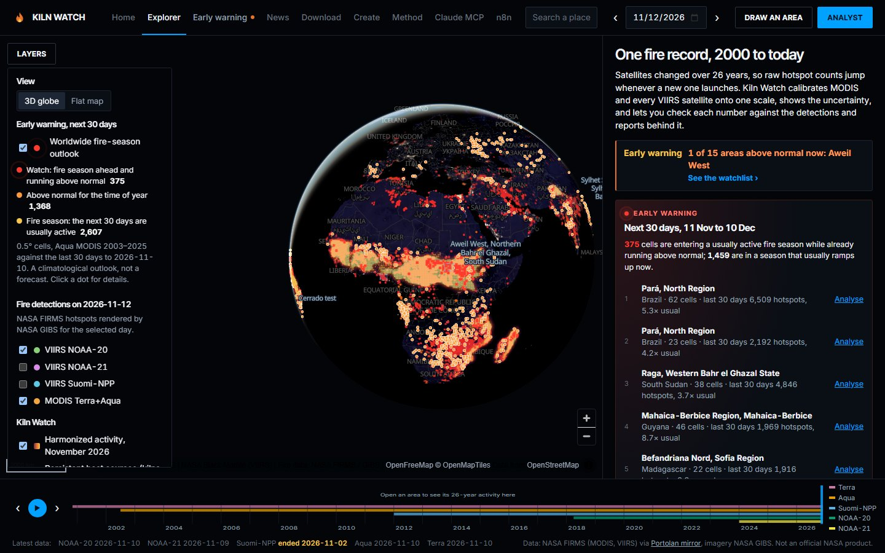<br><b>Globe and 30-day outlook.</b> Every half-degree cell on Earth: what the next 30 days usually bring, and how unusual the last 30 were.</td>
</tr>
<tr>
<td valign="top">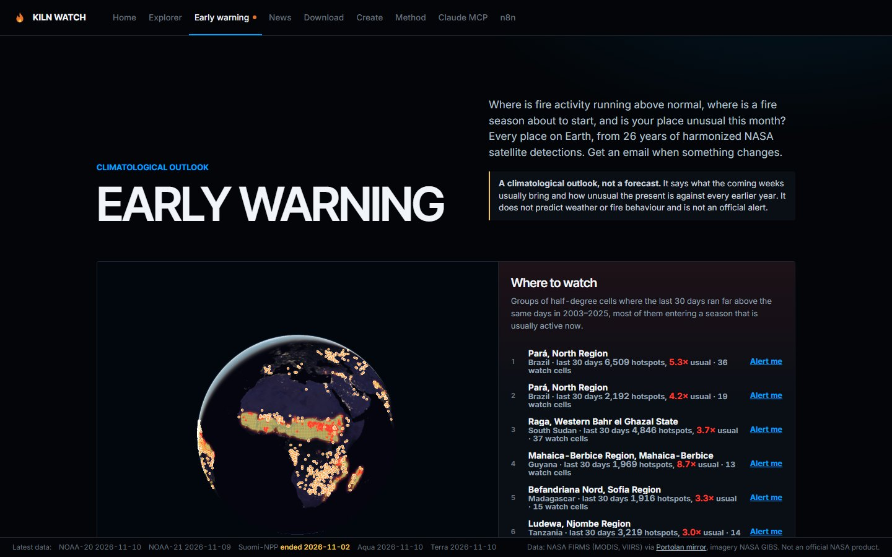<br><b>Early warning.</b> A plain rule printed on the page. It compares with earlier years; it never forecasts. Alerts by email or n8n.</td>
<td valign="top">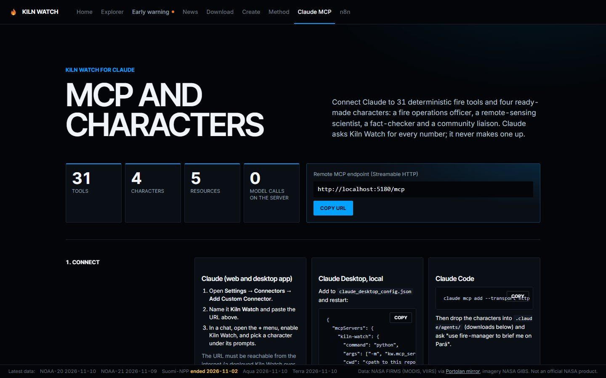<br><b>Ask it anything.</b> A Gemini analyst and a 31-tool MCP server for Claude. The model writes the words; every number comes from the pipeline.</td>
</tr>
</table>

Also in the box: draw-your-own area, weekly view, season start and peak, news and event reports beside the data, CSV and SVG downloads, a printable brief.

---

## Who it is for

| Anywhere on Earth | At home, in Bangladesh |
|---|---|
| **Fire managers** see whether this month is unusual against 26 comparable years, not 14. | **Dhaka's brick-kiln belt** is our home test case, and where raw counts mislead most: a 10.6× false jump. |
| **Scientists** get a record with intervals, provenance and the calibration table to download. | Kilns are small, hot and steady. VIIRS sees them; MODIS mostly cannot. |
| **Everyone after MODIS.** Terra and Aqua are near the end of their lives. The denial test shows the record carries on without them. | We separate them from vegetation fires, so a kiln season is never mistaken for a wildfire season. |

<p align="center">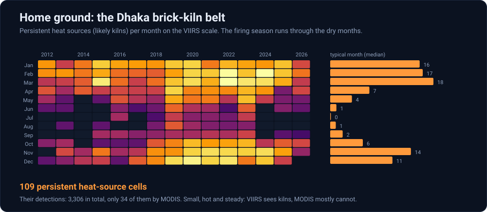</p>

<p align="center"><sub>Labelled "likely kilns": the cells are not yet checked against a kiln inventory. That check is next.</sub></p>

---

## How it is built

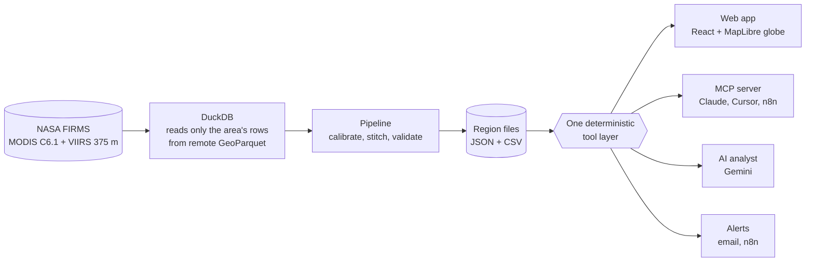

| For the judges | Where to look |
|---|---|
| **Best Use of Data** | Every number traces to FIRMS detections. Denial tests, placebo tests, measured interval coverage. Downloads for all of it. |
| **Best Use of Technology** | Remote GeoParquet queried in place. One tool layer behind the app, the AI analyst and a remote MCP endpoint. |
| **Galactic Impact** | A record that survives the end of MODIS, a worldwide outlook, and alerts for any box on Earth. |
| **Local Impact** | Bangladesh's kiln belt, separated from vegetation fire and tracked by season. |

<details>
<summary><b>Run it</b> (Python 3.11+, Node 20+)</summary>

```bash
cd server && pip install -r requirements.txt
uvicorn kw.api:app --port 8000        # built regions are committed: calendars work at once

cd web && npm install && npm run dev  # http://localhost:5173
```

Rebuild from NASA data: `python -m kw.firms && python -m kw.build`. Any-place builds in about 20 s: `python -m kw.globe` (one-off, 1.8 GB).
Tests: `python server/tests/test_science.py`. Figures on this page: `node scripts/readme_figures.mjs`.
Analyst key, MCP setup, email alerts and deployment: [docs/TECHNICAL.md](docs/TECHNICAL.md).

</details>

<details>
<summary><b>Data and credits</b></summary>

<br>

| Source | Used for |
|---|---|
| **NASA FIRMS** (MODIS C6.1, VIIRS 375 m C2), read from the Portolan GeoParquet mirror (CC0) | Every detection and every number |
| **NASA GIBS**, **NASA Black Marble** (VIIRS Day/Night Band), **NASA Blue Marble** | Daily fire layers, imagery, night lights |
| **NASA EONET**, GDACS (EC JRC, UN OCHA) | Wildfire events |
| GDELT Project, Google News RSS | News reports beside the data |
| NASA 3D Resources | Satellite models on the home page |
| OpenFreeMap, OpenStreetMap, Nominatim | Base map and place search |
| DuckDB, FastAPI, MCP Python SDK, React, MapLibre GL JS, three.js, GSAP, Lenis, Vite | Software |

We acknowledge the use of data and imagery from NASA's Fire Information for Resource Management System (FIRMS)
(https://earthdata.nasa.gov/firms), part of NASA's Earth Observing System Data and Information System (EOSDIS).

**AI use.** Built with AI assistance (Claude Code); the in-app analyst uses Google Gemini. No AI system produces any number
in the calendar, charts or downloads. Details: [AI_USE.md](AI_USE.md).

Detections are not fires and not burned area. Kiln Watch is an independent project, not an official NASA product.

</details>

---

## Team Off The Binary

<p align="center"><i>From Bangladesh</i></p>

<table align="center">
<tr>
<td align="center" width="33%"><b>Aalvee Aarham</b><br><sub>AI SYSTEMS ARCHITECT & PROJECT LEAD</sub></td>
<td align="center" width="33%"><b>Israt Jahan Arna</b><br><sub>FRONTEND ENGINEERING LEAD</sub></td>
<td align="center" width="33%"><b>Sajid Alam Chowdhury Omee</b><br><sub>BACKEND SYSTEMS ENGINEER</sub></td>
</tr>
<tr>
<td align="center"><b>Nazifa Jahan</b><br><sub>RESEARCH & INNOVATION LEAD</sub></td>
<td align="center"><b>Maruf Hasan Tawhid</b><br><sub>DATA ACQUISITION & DATA ANALYST</sub></td>
<td align="center"><b>Muhammad Ahnaf Sarker</b><br><sub>LEAD AI/ML DEVELOPER</sub></td>
</tr>
</table>
